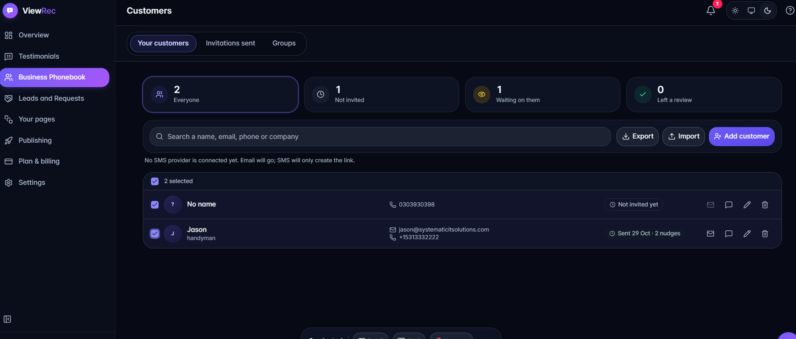
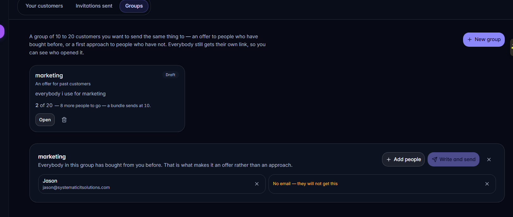
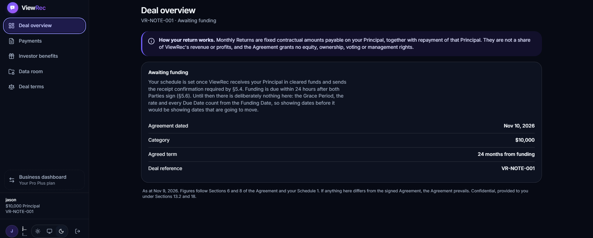

# Systematic Work — selected engineering

Selected code from **ViewRec**, a video-testimonial platform for small
businesses: customers record a short video review from a link, the business
approves it, and it publishes to their review page, their website and their
social accounts.

> **This is an excerpt, not the product.** A handful of files chosen to show
> how the code is written and reasoned about. The application itself — its
> build configuration, authentication, billing, payment gateway, API routes
> and the other ~290 source files — is not here, and nothing in this
> repository builds or runs on its own.

**Stack:** Next.js 16 (App Router) · React 19 · TypeScript · Tailwind v4 ·
MySQL 8.4 · server actions, no REST layer between the app and its own data.

---

## What it looks like

### The business dashboard

Every customer a business can ask, what has been sent, and who replied.

### Groups

Up to twenty customers who get the same thing — an offer to past customers,
or a first approach to people who have not bought yet. Each person still
gets their own link, so the business can see who opened it rather than
knowing only that somebody did.

### The investor portal

A separate role with its own area: lenders see their payment schedule, what
has been paid, and the confirmations the financing agreement obliges the
company to send.

---

## What is in here

| Path | What it is |
|------|------------|
| `backend/lib/reorder.ts` | Moving one entry around a list — two pure functions |
| `backend/lib/bundles.ts` | How large a group may be, and what the sizes mean |
| `backend/server/automations-repo.ts` | Scheduled work: reads, writes, and the claim |
| `backend/server/automations-run.ts` | The sweep that runs what is due |
| `frontend/panel.tsx` | The design-system primitive every screen is built from |
| `frontend/section-tabs.tsx` | Tabs a person can drag into their own order |
| `frontend/automations-view.tsx` | A screen, end to end |
| `database/035-automations.sql` | One migration, with its constraints argued for |
| `tests/test-reorder.mjs` | The test suite for the list arithmetic |

---

## How this code is written

Four habits run through all of it. They are easier to see in the files than
to describe, but here is what to look for.

### Comments say *why*, and name the failure they prevent

Not what the line does — the line already says that. What goes wrong
without it, usually with the actual incident attached.

From `automations-repo.ts`, on claiming a job:

> **Running one is a claim.** `claimDue` flips 'scheduled' to 'running' in
> a statement whose WHERE tests the status it is changing, so two cron
> calls a second apart cannot both send the same email to the same group.
> That is the same discipline the publish queue uses, and for the same
> reason: the failure it prevents is the one nobody sees until a customer
> complains about being emailed twice.

From `automations-run.ts`, on why every run is wrapped individually:

> Every run is wrapped. A single automation that throws must not take the
> sweep down with it, because the next row behind it has done nothing
> wrong - that exact failure once left a publishing queue frozen for two
> days with nothing written anywhere to say why.

### The database decides, not the code

Work that must happen once is claimed with an `UPDATE` whose `WHERE` tests
the state it is changing, so concurrency is settled by the database rather
than by the order two processes happened to arrive in. A repeating job is
rescheduled forward from *now*, never from the date it missed — counting
from the missed date would fire it again immediately, and again, until it
caught up with every run it slept through. For an email to a group, that is
the same group emailed five times in a minute.

### Constraints carry their reasoning

`035-automations.sql` is a migration with an argument in it. Including the
one place MySQL would not cooperate, and why that turned out to be the
schema catching a contradiction rather than the schema being in the way:

> `bundle_id` is deliberately NOT in this rule, and the reason is the
> foreign key above. MySQL refuses a CHECK over a column that a
> referential action writes to - ON DELETE SET NULL has to be able to
> put a NULL there - and the two together were a contradiction anyway:
> the column cannot both be allowed to become NULL and be forbidden
> from being NULL.

### Tests exist where something was once silently wrong

`reorder.ts` is four functions of array arithmetic, and it has twenty-four
assertions, because the previous version of that logic shipped broken and
nothing noticed: a one-line dedupe used `Set.add` as a predicate, `Set.add`
returns the set, so every stored id was dropped and a person's saved menu
order silently never applied. It looked right and did nothing — the worst
way for a bug to behave.

The test file says so at the top, so the next person to read it knows why
four small functions are worth that much coverage.

---

## A few decisions worth reading about

**Dates that are days, not moments.** Payment due dates are stored as `DATE`
and not `DATETIME`. The 15th of March is the 15th of March wherever it is
read; holding one as an instant means every reader is one timezone away from
answering the 14th.

**Money as whole cents, never floats.** And a payment schedule that is
*computed* from the agreement's own terms rather than stored — so correcting
a funding date re-dates the whole schedule at once, instead of leaving
twenty-one saved rows to be hunted down. A saved schedule that disagrees
with the signed agreement is worse than no saved schedule.

**Nothing commercial goes out without a way to stop it.** The group mailer
refuses to send to an address it cannot build an unsubscribe link for.
Commercial mail nobody can stop is the one outcome worse than not sending
it.

**One rule, one answer.** A group used to need ten people before it could be
emailed from one screen, while a scheduled automation would email a group of
two without complaint — the same rule giving two answers depending on which
screen you were standing on. The rule was removed rather than copied into
the second place, and the test that guarded the old minimum was kept,
pointed the other way, so it cannot quietly return.

---

## Accessibility is not a pass at the end

Every rearrangeable list has two ways to move things: a pointer drag, and a
pair of arrow buttons — a drag is unusable with a keyboard and awkward on a
touchscreen. Every move announces where the thing landed, because a list
that rearranges itself in silence is one a screen-reader user cannot tell
has changed. `section-tabs.tsx` shows both paths in about forty lines.

---

Code © Systematic IT Solutions. Published here as a work sample; not
licensed for reuse.
